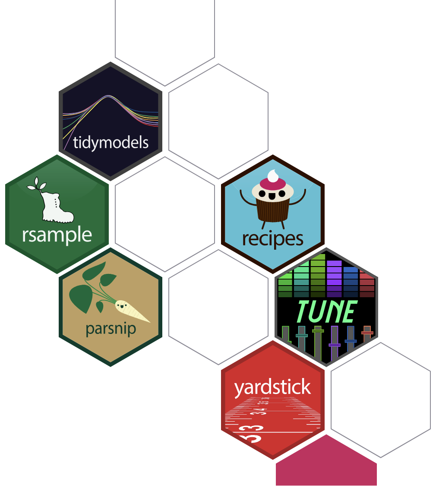
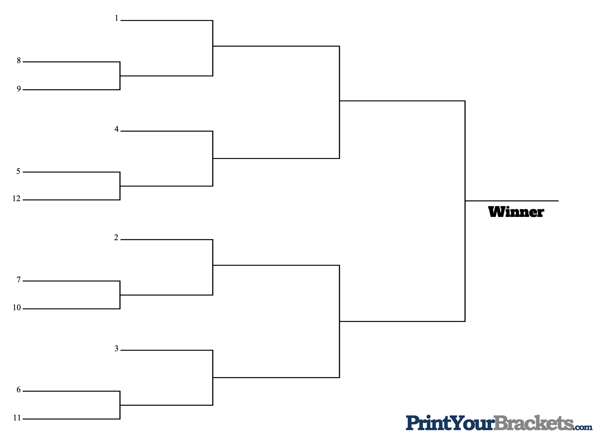

```{r}
#| include: false
#| warning: false
#| message: false

knitr::opts_chunk$set(echo = TRUE, warning = FALSE, message = FALSE,
                      fig.retina = 3, fig.align = 'center')
library(knitr)
library(tidyverse)
library(palmerpenguins)
library(cowplot)
library(moderndive)
library(ggthemes)
library(ISLR)
library(rsample)
library(ggforce)
```

::::: columns
::: {.column .center width="55%"}
{width="90%"}
:::

::: {.column .center width="45%"}
<br>

[Regression Competition]{.custom-title}

<br> <br>

[Grayson White]{.custom-subtitle}

[Stat 243 <br> Week 7 \| Fall 2026]{.custom-subtitle}
:::
:::::

------------------------------------------------------------------------

## Announcements

::: {.nonincremental}

- Don't forget about Group Project Assignment 1!
    - Deadline to turn in the proposal for priority feedback is **this Friday**, 10/16.

:::

## Goals for this week

:::: {.columns}

::: {.column width='50%'}

::: {.nonincremental .fragment}

**Monday:**

- Ultimate regression competition showdown!!!

:::

:::

::: {.column width='50%'}

::: {.nonincremental .fragment}

**Wednesday:**

- $k$NN

<br>

**Friday:**

- Quiz on penalized regression. 
- I have decided to **not** assign a Lab on Friday!

:::

:::

::::


# Regression Competition

## Regression Competition


- We will have a 12-player single-elimination bracket style competition, based on your "best" model from Lab 4. 


::: {.fragment}

{width='50%' fig-align='center'}

:::


## Seeding: Stat Learning Trivia


::: {.fragment}

{fig-align='center'}

:::


# Round 1


## Seeding: Stat Learning Trivia (1)


<br>
<br>
<br>

::: {.fade-up .midi .center .fragment .nonincremental}

**Unsupervised** learning refers to a type of statistical learning without 

(a) any continuous variables
(b) a quantitative response variable
(c) any auxiliary variables
(d) any response variables

:::


## Seeding: Stat Learning Trivia (2)


<br>
<br>
<br>

::: {.fade-up .midi .center .fragment .nonincremental}

**Bootstrapping** is useful for ...

(a) Improving predictive performance
(b) Estimating a statistic's center
(c) Estimating a statistic's variation
(d) None of the above

:::


## Seeding: Stat Learning Trivia (3)


<br>
<br>
<br>

::: {.fade-up .midi .center .fragment}

TRUE or FALSE: **Penalized regression** can decrease overall MSE by decreasing bias and increasing variance

:::


## Seeding: Stat Learning Trivia (4)


<br>
<br>
<br>

::: {.fade-up .midi .center .fragment .nonincremental}

As $n\to\infty$, the probability that the $j$th observation is *not* in the bootstrap sample is:

(a) $e^{-1}$
(b) $-e$
(c) $\frac{1}{e}$
(d) Both (a) and (c)


:::


## Seeding: Stat Learning Trivia (5)


<br>
<br>
<br>

::: {.fade-up .midi .center .fragment .nonincremental}

The average test MSE can be decomposed into what three terms? 


(a) bias($\hat f$), variance($\hat f$), variance($\epsilon$)
(b) bias$^2$($\hat f$), variance$^2$($\hat f$), variance($\epsilon$)
(c) bias$^2$($\hat f$), variance($\hat f$), variance($\epsilon$)
(d) Mean, Squared, and Error


:::


## Seeding: Stat Learning Trivia (6)


<br>
<br>
<br>

::: {.fade-up .midi .center .fragment .nonincremental}

MAD, MSE, and MZOL are all examples of what? 

(a) regression functions
(b) step functions
(c) loss functions
(d) found functions

:::


# Round 2

::: {.center}

If you "won" in Round 1 you are in Round 2.

:::


## Seeding: Stat Learning Trivia (7)


<br>
<br>
<br>

::: {.fade-up .midi .center .fragment .nonincremental}

What penalization method also performs variable selection?

:::


## Seeding: Stat Learning Trivia (8)


<br>
<br>
<br>

::: {.fade-up .midi .center .fragment .nonincremental}

A model with low training RSS, but high testing RSS might be doing what to the training data?

:::


## Seeding: Stat Learning Trivia (9)


<br>
<br>
<br>

::: {.fade-up .midi .center .fragment .nonincremental}

Suppose you have 160 training observations and choose to perform 10-fold cross validation. How many observations will be in each fold? 

:::


# Final Round

::: {.center}

If you "lost" in Round 2 you are in the Final Round.

:::


## Seeding: Stat Learning Trivia (10)


<br>
<br>
<br>

::: {.fade-up .midi .center .fragment .nonincremental}


How many authors are there for our main textbook, *ISLR (Second Edition)*?


:::


## Competition time! 


```{r}
#| echo: false
competition <- list(
  models = list(
    Ellarain_Moore_model = function(training_data, testing_data) {
      my_mod <- lm(SalePrice ~ OverallQual + GrLivArea + TotalBsmtSF + YearBuilt,
                   data = training_data)
      
      predict(my_mod, testing_data)
    },
    
    
    Brendan_Fingal_model = function(training_data, testing_data) {
      my_mod <- lm(
        SalePrice ~ Functional + SaleCondition + RoofMatl + LotArea +
          OpenPorchSF + GrLivArea + MoSold +
          poly(OverallQual, degree = 2, raw = TRUE) + EnclosedPorch +
          FullBath,
        data = training_data
      )
      predict(my_mod, testing_data)
    },
    
    
    Tate_Beech_model = function(training_data, testing_data) {
      my_mod <- lm(
        SalePrice ~
          FullBath * HalfBath +
          poly(TotRmsAbvGrd, degree = 2, raw = TRUE) +
          EnclosedPorch +
          Fireplaces +
          GarageArea +
          TotalBsmtSF,
        data = training_data
      )
      predict(my_mod, testing_data)
    },
    
    
    Dane_Vaughn_model = function(training_data, testing_data) {
      my_mod <- lm(SalePrice ~ GrLivArea + OverallQual, data = training_data)
      predict(my_mod, testing_data)
    },
    
    
    Cassia_Post_model = function(training_data, testing_data) {
      my_mod <- lm(
        SalePrice ~ I(OverallQual^2) * GrLivArea + I(TotalBsmtSF^2) +
          GarageCars + YearBuilt,
        data = training_data
      )
      predict(my_mod, testing_data)
    },
    
    Schwa_Yeleti_model = function(training_data, testing_data) {
      my_mod <- lm(SalePrice ~ WoodDeckSF + GrLivArea + YearBuilt + OpenPorchSF,
                   data = training_data)
      predict(my_mod, testing_data)
    },
    
    Jaden_Bauer_model = function(training_data, testing_data) {
      my_mod <- lm(
        SalePrice ~ GarageArea *
          poly(TotRmsAbvGrd, degree = 2, raw = TRUE)
        + TotalBsmtSF * FullBath,
        data = training_data
      )
      predict(my_mod, testing_data)
    },
    
    Anne_Heissenbuttel_model = function(training_data, testing_data) {
      my_mod <- lm(SalePrice ~ OverallQual + I(TotalBsmtSF^2), data = training_data)
      predict(my_mod, testing_data)
    },
    
    
    Ida_Landecker_model = function(training_data, testing_data) {
      library(tidyverse)
      training_data <- training_data %>%
        mutate(log_price = log(SalePrice))
      my_mod <- lm(log_price ~ YearBuilt + GarageCars, data = training_data)
      sigma <- summary(my_mod)$sigma
      exp(predict(my_mod, testing_data) + sigma^2 / 2) 
    },
    
    
    Kaishin_Lin_model = function(training_data, testing_data) {
      my_mod <- lm(
        SalePrice ~ Functional + BldgType + Foundation +
          SaleCondition + RoofMatl +
          GarageCars + LotArea + OpenPorchSF + WoodDeckSF + YrSold +
          MoSold + OverallQual + Fireplaces + EnclosedPorch + FullBath,
        data = training_data
      )
      predict(my_mod, testing_data)
    },
    
    
    Fuxing_Lu_model = function(training_data, testing_data) {
      my_mod <- lm(
        formula = log(SalePrice) ~ OverallQual + TotalBsmtSF + GrLivArea + GarageArea,
        data = training_data
      )
      
      sigma <- summary(my_mod)$sigma
      exp(predict(my_mod, testing_data) + sigma^2 / 2) 
    },
    
    
    Eleanor_Tonn_model = function(training_data, testing_data) {
      my_mod <- lm(log(SalePrice) ~ GarageArea + GrLivArea + OverallQual, data = training_data)
      sigma <- summary(my_mod)$sigma
      exp(predict(my_mod, testing_data) + sigma^2 / 2) 
    }
  ),
  seeds = 12:1
)


```


Training and testing data

:::: .columns

::: {.column}

```{r}
library(tidyverse)
house_test <- read_csv("data/house_test.csv") %>%
  # remove 3 observations that break a few models
  filter(!Id %in% c(146, 1014, 272)) 
str(house_test)
```

:::

::: {.column}

```{r}
house_train <- read_csv("data/house_train.csv")
str(house_train)
```

:::

::::


## Your models

```{r}
str(competition)
competition$models[[1]]
competition$seeds[1]
```


## Compete!

```{r}
compete <- function(seeds, training_data, testing_data, print_rmse) {
  indx1 <- which(competition$seeds == seeds[1])
  indx2 <- which(competition$seeds == seeds[2])
  
  indx1_preds <- competition$models[[indx1]](training_data, testing_data)
  indx2_preds <- competition$models[[indx2]](training_data, testing_data)
  
  rmse1 <- sqrt(mean( (indx1_preds - testing_data$SalePrice)^2 ))
  rmse2 <- sqrt(mean( (indx2_preds - testing_data$SalePrice)^2 ))

  if (print_rmse) {
    if (rmse1 < rmse2) {
      print(paste0("Seed ", seeds[1], " wins with an RMSE of ", round(rmse1, 2),
                   " compared to Seed ", seeds[2], "'s RMSE of ", round(rmse2, 2)))
    } else if (rmse1 > rmse2) {
      print(paste0("Seed ", seeds[2], " wins with an RMSE of ", round(rmse2, 2),
               " compared to Seed ", seeds[1], "'s RMSE of ", round(rmse1, 2)))
    } else {
      print("Tie!")
    }
  }
  
  if (!print_rmse) {
    if (rmse1 < rmse2) {
      print(paste0("Seed ", seeds[1], " wins!"))
    } else if (rmse1 > rmse2) {
      print(paste0("Seed ", seeds[2], " wins!"))
    } else {
      print("Tie!")
    }
  }
  

}
```


# The Play-in


## Play-in: Game 1

```{r}
#| eval: false
compete(c(8, 9), 
        house_train,
        house_test,
        print_rmse = FALSE)
```

## Play-in: Game 1

```{r}
compete(c(8, 9), 
        house_train,
        house_test,
        print_rmse = FALSE)
```


## Play-in: Game 2

```{r}
#| eval: false
compete(c(5, 12),
        house_train, 
        house_test,
        print_rmse = FALSE)
```

## Play-in: Game 2

```{r}
compete(c(5, 12),
        house_train, 
        house_test,
        print_rmse = FALSE)
```


## Play-in: Game 3

```{r}
#| eval: false
compete(c(7, 10), 
        house_train,
        house_test,
        print_rmse = FALSE)
```

## Play-in: Game 3

```{r}
compete(c(7, 10), 
        house_train,
        house_test,
        print_rmse = FALSE)
```

## Play-in: Game 4

```{r}
#| eval: false
compete(c(6, 11), 
        house_train,
        house_test,
        print_rmse = FALSE)
```

## Play-in: Game 4

```{r}
compete(c(6, 11), 
        house_train,
        house_test,
        print_rmse = FALSE)
```

# Round 1

## Round 1: Game 1

```{r}
#| eval: false
# 1 with 8 or 9
compete(c(1, X), 
        house_train,
        house_test,
        print_rmse = FALSE)
```

## Round 1: Game 2

```{r}
#| eval: false
# 4 with 5 or 12
compete(c(4, X), 
        house_train,
        house_test,
        print_rmse = FALSE)
```


## Round 1: Game 3

```{r}
#| eval: false
# 2 with 7 or 10
compete(c(2, X), 
        house_train,
        house_test,
        print_rmse = FALSE)
```


## Round 1: Game 4

```{r}
#| eval: false
# 3 with 6 or 11
compete(c(3, X), 
        house_train,
        house_test,
        print_rmse = FALSE)
```


# Round 2

## Round 2: Game 1

```{r}
#| eval: false
compete(c(X, Y), 
        house_train,
        house_test,
        print_rmse = FALSE)
```


## Round 2: Game 2

```{r}
#| eval: false
compete(c(X, Y), 
        house_train,
        house_test,
        print_rmse = FALSE)
```


# The Finals

## The Finals

```{r}
#| eval: false
compete(c(X, Y), 
        house_train,
        house_test,
        print_rmse = TRUE)
```


## Next time

::: {.nonincremental}

- Lenny will discuss $k$NN.

- On Friday, Marcus will administer and proctor the quiz.

- See you after fall break!
  
:::

