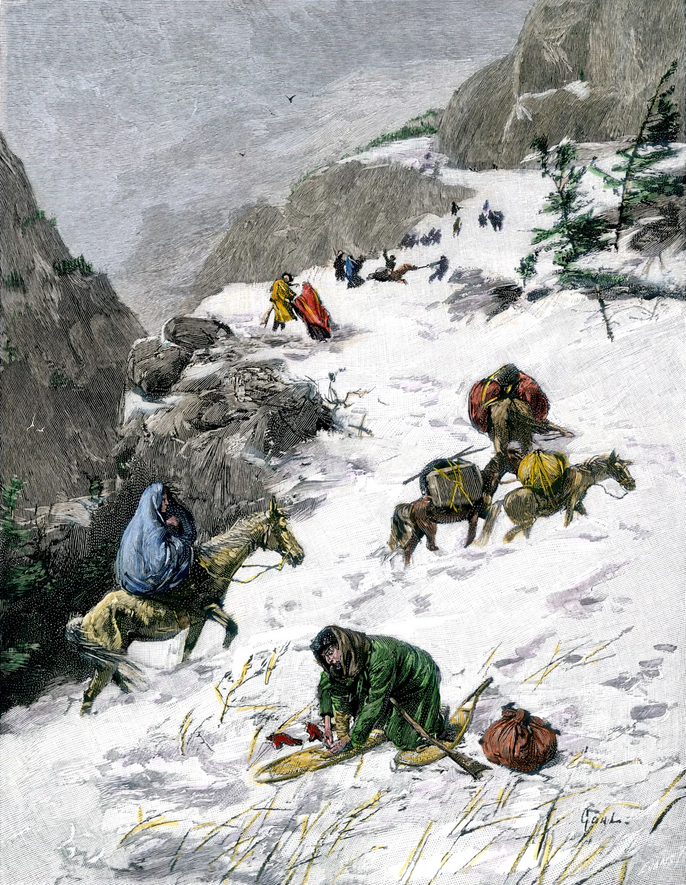
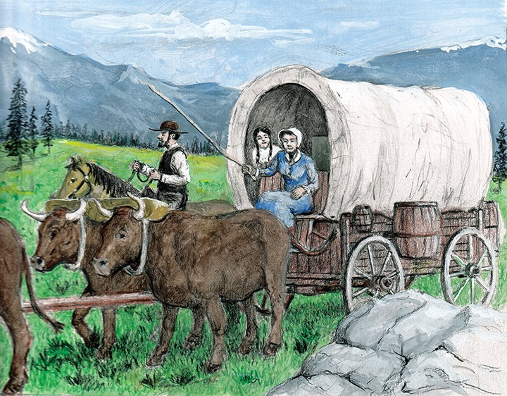

```{r}
#| include: false
#| warning: false
#| message: false

knitr::opts_chunk$set(echo = TRUE, warning = FALSE, message = FALSE,
                      fig.retina = 3, fig.align = 'center')
library(knitr)
library(tidyverse)
library(palmerpenguins)
library(cowplot)
library(moderndive)
library(ggthemes)
library(ISLR)
library(rsample)
library(ggforce)
theme_set(theme_get() + theme(text = element_text(size = 20))) 
```

::::: columns
::: {.column .center width="55%"}
{width="80%"}
:::

::: {.column .center width="45%"}
<br>

[Logistic Regression]{.custom-title}

<br> <br> <br> <br> <br> 

[Grayson White]{.custom-subtitle}

[Stat 243 <br> Fall 2026, Week 8]{.custom-subtitle}
:::
:::::

------------------------------------------------------------------------

## Setting: Springfield, Illinois. April 1846.


::::: columns
::: {.column .center width="55%"}

- Two brothers, George and Jacob decide to leave Illinois and lead a group of migrants to head west to California. 

- Expected trip duration: **four to six months**

- Slowed by taking a new route, the Hastings Cutoff, which crossed the Wasatch mountains and Great Salt Lake Desert.


:::

::: {.column .center width="45%"}

{width="80%"}


:::
:::::

------------------------------------------------------------------------

## Setting: Springfield, Illinois. April 1846.


::::: columns
::: {.column .center width="55%" .nonincremental}

- Two brothers, George and Jacob decide to leave Illinois and lead a group of migrants to head west to California. 

- Expected trip duration: **four to six months**

- Slowed by taking a new route, the Hastings Cutoff, which crossed the Wasatch mountains and Great Salt Lake Desert.

- In early **November**, the "Donner Party" is trapped by an early snowfall in the Sierra Nevada mountains.  

:::

::: {.column .center width="45%"}

{width="80%"}


:::
:::::

------------------------------------------------------------------------

## Data: Donner Party

```{r}
#| output-location: column
library(tidyverse)
library(Sleuth3)
data(case2001)
donner <- case2001 %>%
  as_tibble() %>%
  mutate(Survived = case_when(
    Status == "Survived" ~ 1,
    Status == "Died" ~ 0
  ))
donner
```


- **Q:** What does a row represent? 
    - **A:** Each row represents a member of the Donner Party!
    
    
::: {.fragment .fade-up .midi .center}
    
We'd like to **describe** the relationship between survival in the Donner Party and other recorded variables: `Sex` and `Age` 

:::


------------------------------------------------------------------------

## Exploratory data analysis


```{r}
ggplot(data = donner, 
       mapping = aes(x = Sex, fill = Status)) +
  geom_bar(position = "fill")
```

- What can we learn from this graph? 


------------------------------------------------------------------------


## Exploratory data analysis


```{r}
ggplot(data = donner, 
       mapping = aes(x = Age, y = Status, color = Sex)) + 
  geom_boxplot(color = "black", alpha = 0.5) + 
  geom_point(alpha = 0.5,
             size = 3)
```

::: {.nonincremental}

- What about this one? 

:::


# Can we use a model to estimate the probability of survival given these predictors? 

{fig-align='center' width='100%' .fragment}

------------------------------------------------------------------------

## Recall: Linear Regression

Model Form:

$$ 
\begin{align}
y &= \beta_0 + \beta_1 x_1 + \beta_2 x_2 + \cdots + \beta_p x_p + \epsilon
\end{align}
$$

Linear regression is a flexible class of models that allow for:

::: nonincremental
-   Both quantitative and categorical **explanatory** variables.

-   **Multiple** explanatory variables.

-   BUT the **response variable is quantitative**.
:::

------------------------------------------------------------------------

## Linear Regression for predicting probability of survival

Model Form:

$$ 
\begin{align}
y = P(\text{survival}) = \beta_0 + \beta_1 x_{age} + \beta_2 x_{sex} + \epsilon
\end{align}
$$


::: {.fragment}

```{r}
#| warning: false
#| output-location: column
library(moderndive)
ggplot(data = donner, 
       mapping = aes(x = Age, 
                     y = Survived, 
                     color = Sex)) +
  geom_point(alpha = 0.5,
             size = 3) + 
  geom_parallel_slopes(method = "lm", se = FALSE) + 
  labs(y = "P(Survival)") + 
  theme(legend.position = "bottom")
```

:::


------------------------------------------------------------------------


## Linear Regression for predicting probability of survival


```{r}
#| warning: false
#| output-location: column
library(moderndive)
ggplot(data = donner, 
       mapping = aes(x = Age, 
                     y = Survived, 
                     color = Sex)) +
  geom_point(alpha = 0.5,
             size = 3) + 
  geom_parallel_slopes(method = "lm", se = FALSE) + 
  labs(y = "P(Survival)") + 
  theme(legend.position = "bottom")
```

::: {.nonincremental}

**Think-Pair-Share**:


1. What do the regression lines represent? 

2. What is the estimated probability of survival for 20 year old female members of the Donner Party? 

3. What about the estimated probability of survival for 65 year old male members?


```{r}
#| echo: false
countdown::countdown(2)
```


:::

------------------------------------------------------------------------

## Linear Regression

::: {.nonincremental}

1. **Q:** What do the regression lines represent? 
    - **A:** [Estimated probability of survival for male (blue) and female (salmon) members of the Donner Party.]{.fragment}
    
:::

::: {.nonincremental .fragment}

2. What is the estimated probability of survival for 20 year old female members of the Donner Party? 

3. What about the estimated probability of survival for 65 year old male members?

:::


:::: {.columns}

::: {.column .fragment}


```{r}
library(broom)
linear_mod <- lm(Survived ~ Age + Sex, data = donner)
tidy(linear_mod)
```

:::

::: {.column .fragment}

```{r}
predict(linear_mod, 
        data.frame(Age = c(20, 65),
                   Sex = c("Female", "Male")))
```

:::

::::


------------------------------------------------------------------------


## Linear Regression for binary response data

{fig-align='center' width='80%'}

------------------------------------------------------------------------

## Logistic Regression for binary response data

{fig-align='center' width='80%'}


## Logistic Regression


Logistic regression can be used when:

**Response variable**: A **categorical** variable with **two** categories

```{=tex}
\begin{align*}
Y =   \left\{
\begin{array}{ll}
      1 & \mbox{success} \\
      0 & \mbox{failure} \\
\end{array} 
\right.  
\end{align*}
```
::: fragment
$Y \sim$ Bernoulli$(p)$ where $p = P(Y = 1) = P(\mbox{success})$.
:::

::: fragment
**Explanatory variables**: Can be a mix of categorical and quantitative
:::

::: fragment
**Goal**: Build a model for $P(Y = 1)$.
:::

------------------------------------------------------------------------


## Why can't we use linear regression?

:::: {columns}

::: {.column}
-   Regression line = estimated **probability** of success

-   For valid values of $x$, we are predicting the probability is less than 0 or greater than 1.

:::

::: {.column .fragment}
```{r, echo=FALSE}
set.seed(40)
x <- c(runif(20, 0, .6), runif(20, 0.4, 1))
y <- c(rep(0, 20), rep(1, 20))
dat <- data.frame(x, y)
ggplot(dat, aes(x, y)) +
  geom_point(alpha = 0.5, size = 3) +
  geom_smooth(method = lm, se = FALSE) + 
  labs(y = "P(Y = 1)") 
```
:::

::::


------------------------------------------------------------------------

## Why can't we use linear regression?

:::: {columns}

::: {.column .nonincremental}
-   Regression line = estimated **probability** of success

-   For valid values of $x$, we are predicting the probability is less than 0 or greater than 1.

-   The estimated probabilities based on the logistic regression model are bounded between 0 and 1.
:::

::: {.column}
```{r, echo=FALSE}
set.seed(40)
x <- c(runif(20, 0, .6), runif(20, 0.4, 1))
y <- c(rep(0, 20), rep(1, 20))
dat <- data.frame(x, y)
ggplot(dat, aes(x, y)) +
  geom_point(alpha = 0.5, size = 3) +
  geom_smooth(method = lm, se = FALSE) + 
  labs(y = "P(Y = 1)") +
  geom_smooth(method = 'glm', method.args = list(family = "binomial"), se = FALSE, color = "tomato")
```
:::

::::

::: fragment
What does the **logistic regression model** look like?
:::

------------------------------------------------------------------------

## Logistic Regression Model

```{=tex}
\begin{align*}
\log\left(\frac{P(Y = 1)}{1  - P(Y = 1)}  \right) &= \beta_0 + \beta_1 x_1 + \beta_2 x_2 + \cdots + \beta_p x_p 
\end{align*}
```
::: fragment
Left hand side has many interpretations:

```{=tex}
\begin{align*}
\mbox{LHS} &= \log\left(\frac{P(Y = 1)}{1  - P(Y = 1)}  \right)\\ 
&= \log \left( \mbox{odds (of success)}  \right)\\
&= \mbox{logit}(P(Y = 1))
\end{align*}
```
Note:

$$ 
\mbox{odds} = \frac{\mbox{prob of success}}{\mbox{prob of failure}}
$$
:::

------------------------------------------------------------------------

## Sidebar: Computing Odds

**Q:** If $P(Y = 1) = 0.8$, what are the odds of success?

::: {.fragment}

$$
\text{odds} = \frac{P(Y=1)}{1 - P(Y=1)} = \frac{0.8}{1 - 0.8} = 4
$$

:::

::: {.fragment}

**Q:** What is the maximum value the odds can take? What about the minimum? What about for $\log(\text{odds})$?

:::

- Odds: The minimum value is 0. The maximum is $\infty$.
- $\log(\text{odds})$: The minimum value is $-\infty$. The maximum is $\infty$.


# **Question**: How do we fit the model (the red curve) in R?


```{r, echo=FALSE}
set.seed(40)
x <- c(runif(20, 0, .6), runif(20, 0.4, 1))
y <- c(rep(0, 20), rep(1, 20))
dat <- data.frame(x, y)
ggplot(dat, aes(x, y)) +
  geom_point(alpha = 0.5, size = 3) +
  geom_smooth(method = lm, se = FALSE) + 
  labs(y = "P(Y = 1)") +
  geom_smooth(method = 'glm', method.args = list(family = "binomial"), se = FALSE, color = "tomato")
```


------------------------------------------------------------------------

## Logistic Regression Model in `R`


Instead of a **linear** regression model, let's fit a **logistic** regression model to the Donner Party data! 


```{r}
library(broom)
mod <- glm(Survived ~ Sex, data = donner, family = "binomial")
tidy(mod)
```

::: {.fragment}

Fitted model: 
$$
\log\left(\frac{P(Y = 1)}{1  - P(Y = 1)}  \right) = 0.693 - 1.386 x_{Sex:Male} 
$$

:::


-   But what do the coefficient estimates $\hat{\beta}_0 = 0.693$ and $\hat{\beta}_1 = - 1.386$ represent?


------------------------------------------------------------------------


## Interpretation of Coefficients


What do the coefficient estimates $\hat{\beta}_0 = 0.693$ and $\hat{\beta}_1 = - 1.386$ represent?


:::: {.columns}


::: {.column .fragment width='45%'}

#### When `Sex` = "Female": 

```{=tex}
\begin{align*}
\log\left(\frac{P(Y = 1)}{1  - P(Y = 1)}  \right) &= \log (\text{odds}) \\
& = 0.693 \\
&= \hat\beta_0
\end{align*}
```

Therefore, $\hat\beta_0$ represents the $\log$ of the odds of survival for the baseline group. 

:::

::: {.column width='10%'}
:::


::: {.column .fragment width='45%'}

#### When `Sex` = "Male": 

```{=tex}
\begin{align*}
\log\left(\frac{P(Y = 1)}{1  - P(Y = 1)}  \right) &= \log (\text{odds}) \\
&= 0.693 - 1.386 \\
&= \hat\beta_0 + \hat\beta_1
\end{align*}
```


Therefore, $\hat\beta_1$ represents the change in the $\log$ odds of survival when comparing the baseline group (Female) to Male. 


:::


::::


::: {.fragment .fade-up .midi .center}

Is there a **more intuitive** way to interpret logistic regression coefficients?

:::


------------------------------------------------------------------------

## Interpretation of Coefficients

#### Recall the (2) following definitions:

**(1) Odds:**

$$\text{odds} = \frac{\text{prob of success}}{\text{prob of failure}} = \frac{P(Y = 1)}{1 - P(Y = 1)}$$

and **(2) the logistic regression model**:

$$\log\left(\frac{P(Y = 1)}{1 - P(Y = 1)}\right) = \beta_0 + \beta_1 x_1$$

::: {.fragment}

So then

$$\text{odds} = \exp\left(\beta_0 + \beta_1 x_1\right)$$

:::


------------------------------------------------------------------------


## Interpretation of Coefficients

(Estimated) odds of survival for female members of the Donner Party:

$$\exp\left(\hat{\beta}_0\right)$$

```{r}
exp(0.693)
```


::: {.fragment}

(Estimated) odds of survival for male members of the Donner Party: 

$$\exp\left(\hat{\beta}_0 + \hat{\beta}_1\right)$$


```{r}
exp(0.693 - 1.386)
```


:::


::: {.fragment .fade-up .midi .center}

What about interpreting $\hat\beta_1$ on it's own?

:::


------------------------------------------------------------------------

## Interpretation of Coefficients

#### New concept:

**Odds ratio**: Comparison of odds between two groups

$$\text{odds ratio} = \frac{\text{odds of group 1}}{\text{odds of group 2}}$$

**Interpretation of odds ratio:** The odds of success in group 1 are ___ times the odds of success in group 2.

<br>

::: {.fragment}

**Note:** Also useful property:

$$\exp(a + b) = \exp(a) \exp(b)$$

:::

------------------------------------------------------------------------


## Interpretation of Coefficients


Computing the odds ratio:

$$\frac{\exp\left(\hat{\beta}_0 + \hat{\beta}_1 \right)}{\exp\left(\hat{\beta}_0 \right)} = \frac{\exp(\hat{\beta}_0)\exp(\hat{\beta}_1 )}{\exp(\hat{\beta}_0)} = \exp(\hat{\beta}_1)$$


------------------------------------------------------------------------

## Interpretation of Coefficients

How do we interpret $\hat{\beta}_1 = - 1.386$?

$$\exp(\hat{\beta}_1) = \frac{\text{odds of survival if male} }{\text{odds of survival if female }}$$

<br>

::: {.fragment}

```{r}
exp(-1.386)
1 / exp(-1.386)
```


The estimated odds of survival for female members of the Donner Party are about 4 times that of male members! 

:::


::: {.fragment .fade-up .midi}

What about **quantitative** predictors? 

:::

------------------------------------------------------------------------

## A new model


```{r}
library(broom)
mod2 <- glm(Survived ~ Sex + Age, data = donner, family = "binomial")
tidy(mod2)
```


- Interpretation of $\hat\beta_1 = -1.597$? 


::: {.fragment}

```{r}
1 / exp(-1.597)
```

The estimated odds of survival for female members of the Donner Party is nearly 5 times that of male members, holding age constant.

:::


- Interpretation of $\hat\beta_2 = -0.078$? 

------------------------------------------------------------------------


## Interpretation of Coefficients

(Estimated) odds of survival for $x_{age} = t$ years:

$$\exp\left(\hat{\beta}_0 + \hat{\beta}_1 x_{1} +  \hat{\beta}_2 t\right)$$

::: {.fragment}

(Estimated) odds of survival for $x_{age} = t + 1$ years:

$$\exp\left(\hat{\beta}_0 + \hat{\beta}_1 x_1 +  \hat{\beta}_2 (t + 1)\right)$$

:::

::: {.fragment}

odds ratio:

$$\frac{\exp\left(\hat{\beta}_0 + \hat{\beta}_1 x_{1} +  \hat{\beta}_2 (t + 1)\right)}{\exp\left(\hat{\beta}_0 + \hat{\beta}_1 x_{1} +  \hat{\beta}_2 t\right)} = \frac{\exp\left(\hat{\beta}_0\right)\exp\left(\hat{\beta}_1 x_{1}\right) \exp\left(\hat\beta_2 (t + 1)\right)}{\exp\left(\hat{\beta}_0\right)\exp\left(\hat{\beta}_1 x_{1}\right) \exp\left(\hat\beta_2 t\right)} = \exp(\hat{\beta}_2)$$

:::

------------------------------------------------------------------------

## Interpretation of Coefficients

How do we interpret $\hat{\beta}_2 = -0.078$?

$$\exp(\hat{\beta}_2) = \frac{\text{odds of surviving at age } (t + 1)}{\text{odds of surviving at age t}}$$

<br>

::: {.fragment}

```{r}
exp(-0.078)
```


Holding sex constant, for a 1 year increase in age, the estimated odds of survival are multiplied by 0.925. 

:::

------------------------------------------------------------------------

## Prediction

How can I use this model to predict, for a given sex and age:

(1) the odds of survival,
(2) the probability of survival, and
(3) whether or not we expect survival? 


------------------------------------------------------------------------


## Prediction

How can I use this model to predict, for a given sex and age:

::: {.nonincremental}

(1) **the odds of survival**,
(2) the probability of survival, and
(3) whether or not we expect survival? 


$$
\text{odds} = \frac{P(Y = 1)}{1 - P(Y = 1)} = \exp\left(\hat\beta_0 + \hat\beta_1x_1 + \hat\beta_2x_2\right)
$$

::: {.fragment}

In `R`: 

```{r}
odds <- exp(
  predict(mod2, newdata = data.frame(Age = c(20, 65),
                                     Sex = c("Female", "Male")))
  )
odds
```

:::


:::

------------------------------------------------------------------------

## Prediction

How can I use this model to predict, for a given sex and age:

::: {.nonincremental}

(1) the odds of survival,
(2) **the probability of survival**, and
(3) whether or not we expect survival? 

:::

<br>

```{r}
#| output-location: column
ggplot(donner, aes(x = Age,
                   y = Survived, 
                   color = Sex)) + 
  geom_point(size = 3) + 
  labs(y = "P(Y = 1)") +
  geom_smooth(method = 'glm',
              method.args = list(family = "binomial"),
              se = FALSE)
```


------------------------------------------------------------------------


## Prediction

How can I use this model to predict, for a given sex and age:

::: {.nonincremental}

(1) the odds of survival,
(2) **the probability of survival**, and
(3) whether or not we expect survival? 

:::

<br>

:::: {.nonincremental .columns}


::: {.column}

$$
P(Y = 1) = \frac{\exp\left(\hat\beta_0 + \hat\beta_1x_1 + \hat\beta_2x_2\right)}{1 + \exp\left(\hat\beta_0 + \hat\beta_1x_1 + \hat\beta_2x_2\right)}
$$

:::

::: {.column .fragment}

In `R`: 

```{r}
prob <- odds / (1 + odds)
prob
# or
prob <- predict(mod2,
                newdata = data.frame(Age = c(20, 65),
                                     Sex = c("Female", "Male")), 
                type = "response")
prob
```

:::


::::

------------------------------------------------------------------------


## Prediction

How can I use this model to predict, for a given sex and age:

::: {.nonincremental}

(1) the odds of survival,
(2) the probability of survival, and
(3) **whether or not we expect survival**? 

:::


We can use the **predicted probability** at for an individual to help us predict the **binary outcome**.

$$\widehat{P(Y = 1)} \geq 0.5 \rightarrow \hat{y} = 1$$
$$\widehat{P(Y = 1)} < 0.5 \rightarrow \hat{y} = 0$$


::: {.fragment}

In `R`: 

```{r}
prob >= 0.5
```


:::


------------------------------------------------------------------------


## Predicted probability of survival for each member of the Donner Party


```{r}
preds <- predict(mod2, newdata = donner, type = "response")
head(preds)
```

------------------------------------------------------------------------

## Prediction Accuracy

```{r}
donner %>%
  bind_cols(preds = preds) %>% # quickly add as a column
  mutate(pred_survived = case_when(
    preds >= 0.5 ~ 1,
    preds < 0.5 ~ 0
  )) %>%
  group_by(Survived) %>%
  count(pred_survived)
```

-   Pretty good!
-   How should we quantify our error rates?


------------------------------------------------------------------------


## Recap 

Today, we learned about **logistic regression**, a model suitable when your response variable is **categorical and binary**, but your predictors can be **categorical or quantitative**.


::: {.fragment .nonincremental}

- Logistic regression is similar to linear regression, but we link the response variable to the linear predictor with the log odds or "logit" function: 

$$
\log\left(\frac{P(Y = 1)}{1  - P(Y = 1)}  \right) = \beta_0 + \beta_1 x_1 + \beta_2 x_2 + \cdots + \beta_p x_p 
$$

:::

- Unlike linear regression models, logistic regression models **always predict the probability of success to be between 0 and 1**.

- We have to interpret **odds** and **odds ratios** to interpret the coefficients. 

- We can **predict** many quantities: odds of success, probability of success, and even whether or not we expect success!


