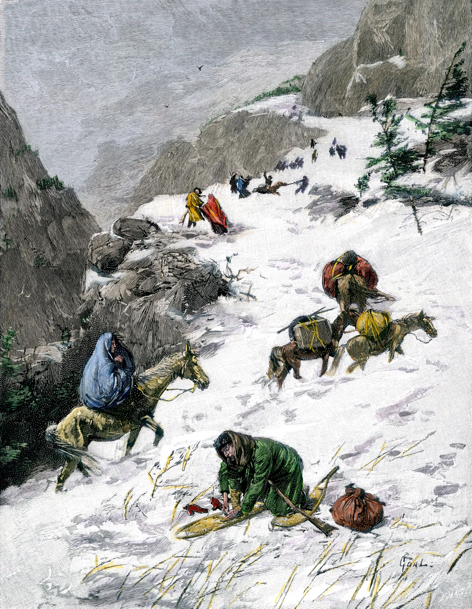

```{r}
#| include: false
#| warning: false
#| message: false

knitr::opts_chunk$set(echo = TRUE, warning = FALSE, message = FALSE,
                      fig.retina = 3, fig.align = 'center')
library(knitr)
library(tidyverse)
library(palmerpenguins)
library(cowplot)
library(moderndive)
library(ggthemes)
library(ISLR)
library(rsample)
library(ggforce)
theme_set(theme_get() + theme(text = element_text(size = 20))) 
```

::::: columns
::: {.column .center width="55%"}
{width="80%"}
:::

::: {.column .center width="45%"}
<br>

[Logistic Regression III]{.custom-title}

<br> <br> <br> <br> <br> 

[Grayson White]{.custom-subtitle}

[Stat 243 <br> Fall 2026, Week 11]{.custom-subtitle}
:::
:::::

------------------------------------------------------------------------

## Recall: Donner Party


::::: columns
::: {.column .center width="55%" .nonincremental}

- Two brothers, George and Jacob decide to leave Illinois and lead a group of migrants to head west to California. 

- Expected trip duration: **four to six months**

- Slowed by taking a new route, the Hastings Cutoff, which crossed the Wasatch mountains and Great Salt Lake Desert.

- In early **November**, the "Donner Party" is trapped by an early snowfall in the Sierra Nevada mountains.  

:::

::: {.column .center width="45%"}

{width="80%"}


:::
:::::

------------------------------------------------------------------------

## Data: Donner Party

```{r}
#| output-location: column
library(tidyverse)
library(Sleuth3)
data(case2001)
donner <- case2001 %>%
  as_tibble() %>%
  mutate(Survived = case_when(
    Status == "Survived" ~ 1,
    Status == "Died" ~ 0
  ))
donner
```

<br>


What does a row represent? 
    


------------------------------------------------------------------------

## Exploratory data analysis


```{r}
ggplot(data = donner, 
       mapping = aes(x = Sex, fill = Status)) +
  geom_bar(position = "fill")
```


------------------------------------------------------------------------


## Exploratory data analysis


```{r}
ggplot(data = donner, 
       mapping = aes(x = Age, y = Status, color = Sex)) + 
  geom_boxplot(color = "black", alpha = 0.5) + 
  geom_point(alpha = 0.5,
             size = 3)
```


## Logistic Regression


Logistic regression can be used when:

**Response variable**: A **categorical** variable with **two** categories

```{=tex}
\begin{align*}
Y =   \left\{
\begin{array}{ll}
      1 & \mbox{success} \\
      0 & \mbox{failure} \\
\end{array} 
\right.  
\end{align*}
```
::: fragment
$Y \sim$ Bernoulli$(p)$ where $p = P(Y = 1) = P(\mbox{success})$.
:::

::: fragment
**Explanatory variables**: Can be a mix of categorical and quantitative
:::

::: fragment
**Goal**: Build a model for $P(Y = 1)$.
:::

------------------------------------------------------------------------


## Why can't we use linear regression?

:::: {columns}

::: {.column}
-   Regression line = estimated **probability** of success

-   For valid values of $x$, we are predicting the probability is less than 0 or greater than 1.

:::

::: {.column .fragment}
```{r, echo=FALSE}
set.seed(40)
x <- c(runif(20, 0, .6), runif(20, 0.4, 1))
y <- c(rep(0, 20), rep(1, 20))
dat <- data.frame(x, y)
ggplot(dat, aes(x, y)) +
  geom_point(alpha = 0.5, size = 3) +
  geom_smooth(method = lm, se = FALSE) + 
  labs(y = "P(Y = 1)") 
```
:::

::::


------------------------------------------------------------------------

## Why can't we use linear regression?

:::: {columns}

::: {.column .nonincremental}
-   Regression line = estimated **probability** of success

-   For valid values of $x$, we are predicting the probability is less than 0 or greater than 1.

-   The estimated probabilities based on the logistic regression model are bounded between 0 and 1.
:::

::: {.column}
```{r, echo=FALSE}
set.seed(40)
x <- c(runif(20, 0, .6), runif(20, 0.4, 1))
y <- c(rep(0, 20), rep(1, 20))
dat <- data.frame(x, y)
ggplot(dat, aes(x, y)) +
  geom_point(alpha = 0.5, size = 3) +
  geom_smooth(method = lm, se = FALSE) + 
  labs(y = "P(Y = 1)") +
  geom_smooth(method = 'glm', method.args = list(family = "binomial"), se = FALSE, color = "tomato")
```
:::

::::

::: fragment
What does the **logistic regression model** look like?
:::

------------------------------------------------------------------------

## Logistic Regression Model

```{=tex}
\begin{align*}
\log\left(\frac{P(Y = 1)}{1  - P(Y = 1)}  \right) &= \beta_0 + \beta_1 x_1 + \beta_2 x_2 + \cdots + \beta_p x_p 
\end{align*}
```
::: fragment
Left hand side has many interpretations:

```{=tex}
\begin{align*}
\mbox{LHS} &= \log\left(\frac{P(Y = 1)}{1  - P(Y = 1)}  \right)\\ 
&= \log \left( \mbox{odds (of success)}  \right)\\
&= \mbox{logit}(P(Y = 1))
\end{align*}
```
Note:

$$ 
\mbox{odds} = \frac{\mbox{prob of success}}{\mbox{prob of failure}}
$$
:::


# **Question**: How do we fit the model (the red curve) in R?


```{r, echo=FALSE}
set.seed(40)
x <- c(runif(20, 0, .6), runif(20, 0.4, 1))
y <- c(rep(0, 20), rep(1, 20))
dat <- data.frame(x, y)
ggplot(dat, aes(x, y)) +
  geom_point(alpha = 0.5, size = 3) +
  geom_smooth(method = lm, se = FALSE) + 
  labs(y = "P(Y = 1)") +
  geom_smooth(method = 'glm', method.args = list(family = "binomial"), se = FALSE, color = "tomato")
```


------------------------------------------------------------------------

## Logistic Regression Model in `R`


Instead of a **linear** regression model, let's fit a **logistic** regression model to the Donner Party data! 


```{r}
library(broom)
mod <- glm(Survived ~ Sex + Age + Sex*Age, data = donner, family = "binomial")
tidy(mod)
```

::: {.fragment}

Fitted model: 
$$
\log\left(\frac{P(Y = 1)}{1  - P(Y = 1)}  \right) = 7.25 - 6.93 x_{Sex:Male} - 0.19 x_{Age} + 0.16 x_{SexMale:Age}
$$

:::


------------------------------------------------------------------------


## Plotting our model


```{r}
ggplot(donner, aes(x = Age, y = Survived, color = Sex)) +
  geom_point(alpha = 0.5, size = 3) +
  labs(y = "P(Y = 1)") +
  geom_smooth(method = 'glm', method.args = list(family = "binomial"), se = FALSE)
```


------------------------------------------------------------------------

## Prediction

How can I use this model to predict, for a given sex and age:

(1) the odds of survival,
(2) the probability of survival, and
(3) whether or not we expect survival? 


------------------------------------------------------------------------


## Prediction

How can I use this model to predict, for a given sex and age:

::: {.nonincremental}

(1) **the odds of survival**,
(2) the probability of survival, and
(3) whether or not we expect survival? 


$$
\text{odds} = \frac{P(Y = 1)}{1 - P(Y = 1)} = \exp\left(\hat\beta_0 + \hat\beta_1x_1 + \hat\beta_2x_2 + \hat\beta_3x_1 x_2\right)
$$

::: {.fragment}

In `R`: 

```{r}
odds <- exp(
  predict(mod, newdata = data.frame(Age = c(20, 65),
                                    Sex = c("Female", "Male")))
  )
odds
```

:::


:::

------------------------------------------------------------------------

## Prediction

How can I use this model to predict, for a given sex and age:

::: {.nonincremental}

(1) the odds of survival,
(2) **the probability of survival**, and
(3) whether or not we expect survival? 

:::

<br>

```{r}
#| output-location: column
ggplot(donner, aes(x = Age,
                   y = Survived, 
                   color = Sex)) + 
  geom_point(size = 3) + 
  labs(y = "P(Y = 1)") +
  geom_smooth(method = 'glm',
              method.args = list(family = "binomial"),
              se = FALSE)
```


------------------------------------------------------------------------


## Prediction

How can I use this model to predict, for a given sex and age:

::: {.nonincremental}

(1) the odds of survival,
(2) **the probability of survival**, and
(3) whether or not we expect survival? 

:::

<br>

:::: {.nonincremental .columns}


::: {.column}

$$
P(Y = 1) = \frac{\exp\left(\hat\beta_0 + \hat\beta_1x_1 + \hat\beta_2x_2 + \hat\beta_3x_1 x_2\right)}{1 + \left(\hat\beta_0 + \hat\beta_1x_1 + \hat\beta_2x_2 + \hat\beta_3x_1 x_2\right)}
$$

:::

::: {.column .fragment}

In `R`: 

```{r}
prob <- odds / (1 + odds)
prob
# or
prob <- predict(mod,
                newdata = data.frame(Age = c(20, 65),
                                     Sex = c("Female", "Male")), 
                type = "response")
prob
```

:::


::::

------------------------------------------------------------------------


## Prediction

How can I use this model to predict, for a given sex and age:

::: {.nonincremental}

(1) the odds of survival,
(2) the probability of survival, and
(3) **whether or not we expect survival**? 

:::


We can use the **predicted probability** at for an individual to help us predict the **binary outcome**.

$$\widehat{P(Y = 1)} \geq 0.5 \rightarrow \hat{y} = 1$$
$$\widehat{P(Y = 1)} < 0.5 \rightarrow \hat{y} = 0$$


::: {.fragment}

In `R`: 

```{r}
prob >= 0.5
```


:::


------------------------------------------------------------------------


## Predicted probability of survival for each member of the Donner Party


```{r}
preds <- predict(mod, newdata = donner, type = "response")
head(preds)
```

------------------------------------------------------------------------

## Prediction Accuracy

```{r}
donner %>%
  bind_cols(preds = preds) %>% # quickly add as a column
  mutate(pred_survived = case_when(
    preds >= 0.5 ~ 1,
    preds < 0.5 ~ 0
  )) %>%
  group_by(Survived) %>%
  count(pred_survived)
```

-   Pretty good!
-   How should we quantify our error rates?


------------------------------------------------------------------------

## Confusion Matrix

Let's see how well our model performs on the training data!

-   First, obtain predictions for `Survived` based on model and 0.5 cutoff:

::: fragment
```{r}
probs <- predict(mod, newdata = donner, type = "response")
preds <- ifelse(probs >= 0.5, 1, 0)
```
:::

-   Second, create a **confusion matrix** between `preds` and `truth`:

::: fragment
```{r}
truth <- donner$Survived
table(preds, truth)
```

e.g., there were 11 members of the Donner Party who *survived* that we predicted would *not* survive.
:::

------------------------------------------------------------------------

## Error Measures

Recall the **Mean Zero-One Loss** or **Error Rate** is the proportion of incorrect classifications:

$$
\textrm{MZOL} = \frac{1}{n} \sum_{i=1}^n I(y_i \neq \hat{y}_i)
$$

-   `accuracy()` function from `yardstick` returns proportion of *correct* predictions:

::: fragment
```{r}
library(yardstick)
results <- data.frame(truth = factor(truth), preds = factor(preds), probs)
accuracy(results, truth = truth, estimate = preds)
```
:::

-   To obtain the mean zero-one loss / error rate, we can subtract our accuracy from 1:

::: fragment
```{r}
acc <- accuracy(results, truth = truth, estimate = preds)$.estimate
1 - acc
```
:::

------------------------------------------------------------------------

## Changing the Classification Cut-off

The *classic* classification procedure chooses the most likely class according to the model:

$$
\hat{Y} = \begin{cases} 1,& \textrm{ if } p(X) \geq 0.5,\\ 0,& \textrm{ if } p(X) < 0.5
\end{cases}
$$

::: fragment
But we can change the cut-off of 0.5 to:

$$
\hat{Y} = \begin{cases} 1,& \textrm{ if } p(X) \geq c_0,\\ 0,& \textrm{ if } p(X) < c_0
\end{cases}
$$

for some new cut-off $c_0$ between 0 and 1.
:::

-   **Q:** What are implications of choosing $c_0 < 0.5$? [Easier to predict $\hat{Y}=1$]{.fragment}

-   **Q:** What are implications of choosing $c_0 > 0.5$? [Harder to predict $\hat{Y}=1$]{.fragment}

-   **Q:** Why might we change our cut-off? [To control types of errors!]{.fragment}

------------------------------------------------------------------------

## Sensitivity and Specificity

For a given classification cut-off,

-   **Sensitivity:** Proportion of *"successes"* ($Y=1$, survived) correctly classified

-   **Specificity:** Proportion of *"failures"* ($Y=0$, died) correctly classified

<br>

::: fragment
By:

-   *decreasing* the classification cut-off, we *increase* sensitivity and *reduce* specificity

-   *increasing* the classification cut-off, we *reduce* sensitivity and *increase* specificity
:::

<br>

::: fragment
[How do we choose a cut-off to best **balance this trade-off?**]{style="color: tomato;"}
:::

------------------------------------------------------------------------

## Receiver Operating Characteristic (ROC) Curves

**ROC curves** plot Sensitivity vs. (1 - Specificity), based on classification probabilities.

::: nonincremental
-   **Sensitivity:** Proportion of *"successes"* ($Y=1$) correctly classified as $\hat{Y} = 1$

-   **(1 - Specificity):** Proportion of *"failures"* ($Y=0$) [incorrectly]{.underline} classified as $\hat{Y} = 1$

-   Cutoff $c_0$ is decreasing as we move from left to right.
:::

:::: columns
::: {.column width="50%"}
```{r}
#| echo: false
#| out-width: "80%"
r <- roc_curve(data = results, truth = truth, probs, event_level = "second")
autoplot(r)
```
:::

::: {.column width="45%"}
::: fragment
**Q:** What does the ROC curve look like for a perfectly accurate model?
:::

::: fragment
-   Straight line up, then across
:::

<br>

::: fragment
**Q:** What does the "kink" in the ROC curve correspond to?
:::

::: fragment
-   Value of $c_0$ when sensitivity stops improving as much
:::
:::
::::

------------------------------------------------------------------------

## ROC Curves in R

The `roc_curve` function in the `yardstick` package can create ROC curves.

```{r}
r <- roc_curve(data = results, truth = truth, probs, event_level = "second")
autoplot(r)
```

------------------------------------------------------------------------

## ROC Curves in R

What is the ideal cutoff, $c_0$?

-   Generally, $c_0$ corresponding to "kink" in the ROC curve.

-   i.e., $c_0$ for which ROC curve is closest to point $(0,1)$

::: fragment
```{r}
r$distance <- sqrt((0 - (1 - r$specificity))^2 + (1 - r$sensitivity)^2)
r %>% arrange(distance) %>% head(4)

best_c0 <- r %>% arrange(distance) %>% slice(1) %>% pull(.threshold)
```
:::

::: fragment
**"Kink" Cut-off = `r round(best_c0, 4)`**
:::

------------------------------------------------------------------------

## Confusion Matrices, Compared

Let's compare confusion matrices based on $c_0 = 0.5$ vs. $c_0 = `r round(best_c0, 4)`$

<br>

:::: columns
::: {.column width="45%"}
**$c_0 = 0.5$**

```{r}
preds_05 <- ifelse(probs >= 0.5, 1, 0)
table(preds = preds_05, truth)
```
:::

::: {.column width="45%"}
**$c_0 = `r round(best_c0, 4)`$**

```{r}
preds_best <- ifelse(probs >= best_c0, 1, 0)
table(preds = preds_best, truth)
```
:::
::::

::: fragment

<br>

Comparing error rates
```{r}
#| echo: false
metrics_at <- function(c0) {
  p <- ifelse(probs >= c0, 1, 0)
  tibble(cutoff      = round(c0, 4),
         error_rate  = mean(p != truth),
         sensitivity = mean(p[truth == 1] == 1),
         specificity = mean(p[truth == 0] == 0))
}
bind_rows(metrics_at(0.5), metrics_at(best_c0))
```
:::


# Logistic and Linear Regression as **Generalized Linear Models**


------------------------------------------------------------------------

## Next time

- We'll dive deeper into the logistic regression model and linear regression model as **generalized linear models**

