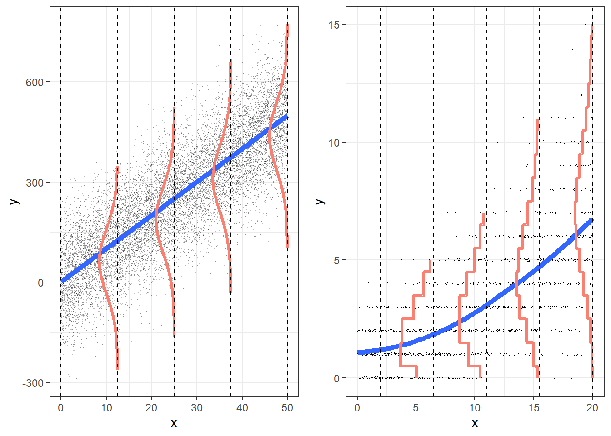

```{r}
#| include: false
#| warning: false
#| message: false

knitr::opts_chunk$set(echo = TRUE, warning = FALSE, message = FALSE,
                      fig.retina = 3, fig.align = 'center')
library(knitr)
library(tidyverse)
library(palmerpenguins)
library(cowplot)
library(moderndive)
library(ggthemes)
library(ISLR)
library(rsample)
library(ggforce)
theme_set(theme_get() + theme(text = element_text(size = 20))) 
```

::::: columns
::: {.column .center width="55%"}
{width="90%"}
:::

::: {.column .center width="45%"}
<br>

[Generalized Linear Models]{.custom-title}

<br> <br> <br> <br> <br> 

[Grayson White]{.custom-subtitle}

[Stat 243 <br> Fall 2026, Week 12]{.custom-subtitle}
:::
:::::

------------------------------------------------------------------------

## Announcements


::: {.nonincremental}

-   Lab 9 released. Due 12/4. 
-   Lab 10 to be released 12/4, covering Week 12 and 13 content (GLMs and LMMs). 

:::


------------------------------------------------------------------------

## Two models


**Linear Regression:**

\begin{align*}
y_i &= \beta_0 + \beta_1 x_{1i} + \cdots + \beta_p x_{pi} + \epsilon_i \\
\epsilon_i &\overset{\text{iid}}{\sim} N(0, \sigma^2)
\end{align*}

<br>

**Logistic Regression:**

$$
\log \left( \frac{P(y_i = 1)}{1 - P(y_i = 1)} \right) = \beta_0 + \beta_1 x_{1i} + \cdots + \beta_p x_{pi}
$$

$$
y_i \overset{\text{ind}}{\sim} Bern(p_i), \textrm{where}~p_i = P(y_i = 1)
$$


# Both Logistic and Linear Regression can be written as **Generalized Linear Models**


------------------------------------------------------------------------

## Generalized Linear Models (GLMs)

A generalized linear model has three components: 

1. A distribution of $y_i$
2. A link function, $g(\mu_i)$, where $\mu_i = \mathbb{E}(y_i)$
3. Linear predictor, $\eta_i$


::: {.fragment}

A GLM is written as follows: 

$$
y_i \overset{\text{ind}}{\sim} Dist(g^{-1}(\eta_i))
$$

where:

::: {.nonincremental}

- $Dist$ is the assumed distribution of $y_i$,
- $g^{-1}(\eta_i)$ is the value of the inverse link, which is $\mu_i$, and 
- $\eta_i$ is the linear predictor. 

:::

:::


## Logistic regression fully specified as a GLM


**Logistic Regression:**

$$
\log \left( \frac{P(y_i = 1)}{1 - P(y_i = 1)} \right) = \beta_0 + \beta_1 x_{1i} + \cdots + \beta_p x_{pi}
$$

$$
y_i \overset{\text{ind}}{\sim} Bern(p_i), \textrm{where}~p_i = P(y_i = 1)
$$

::: {.fragment}

**Logistic Regression (as a GLM):**

$$
y_i \overset{\text{ind}}{\sim} Bern\left(\frac{\exp(\beta_0 + \beta_1 x_{1i} + \cdots + \beta_p x_{pi})}{1 + \exp(\beta_0 + \beta_1 x_{1i} + \cdots + \beta_p x_{pi})}\right)
$$

:::


1. Distribution of $y_i$: Bernoulli
2. Link function: logit; $g(p_i) = \log\left(\frac{p_i}{1 - p_i}\right)$, so $p_i = g^{-1}(\eta_i) = \frac{\exp(\eta_i)}{1 + \exp(\eta_i)}$
3. Linear predictor: $\eta_i = \beta_0 + \beta_1 x_{1i} + \cdots + \beta_p x_{pi}$


## Assumptions for logistic regression

Now that we have written down the logistic regression model, 

$$
y_i \overset{\text{ind}}{\sim} Bern\left(\frac{\exp(\beta_0 + \beta_1 x_{1i} + \cdots + \beta_p x_{pi})}{1 + \exp(\beta_0 + \beta_1 x_{1i} + \cdots + \beta_p x_{pi})}\right),
$$

we can see its assumptions: 

1. **Binary Response:** The response variable is dichotomous (two possible responses).
2. **Independence:** The observations must be independent of one another.
3. **Variance Structure:** By definition, the variance of a Bernoulli random variable is $p(1−p)$, so that variability is highest when $p=.5$.
4. **Linearity:** The log odds, $\log\left(\frac{p}{1−p}\right)$, must be a linear function of $x$.


## Your turn: Write the linear regression model as a GLM

**Linear Regression:**

\begin{align*}
y_i &= \beta_0 + \beta_1 x_{1i} + \cdots + \beta_p x_{pi} + \epsilon_i \\
\epsilon_i &\overset{\text{iid}}{\sim} N(0, \sigma^2)
\end{align*}

::: {.fragment}

**Linear Regression (as a GLM):**

$$
y_i \overset{\text{ind}}{\sim} N(\beta_0 + \beta_1 x_{1i} + \cdots + \beta_p x_{pi},~ \sigma^2)
$$

:::


1. Distribution of $y_i$: Normal
2. Link function: identity; $g(\mu_i) = \mu_i$, so $\mu_i = g^{-1}(\eta_i) = \eta_i$
3. Linear predictor: $\eta_i = \beta_0 + \beta_1 x_{1i} + \cdots + \beta_p x_{pi}$


```{r}
#| echo: false
countdown::countdown(5)
```


## Consider

- Why is it important that we use the link function $g(p_i) = \log\left(\frac{p_i}{1 - p_i}\right)$ for logistic regression? 

- Why is it okay that we use the identity link in linear regression? 


## Probit regression

Consider the following GLM: 

1. Distribution of $y_i$: Bernoulli
2. Link function: "probit"; 
    - $g(p_i) = \Phi^{-1}(p_i)$, so $p_i = g^{-1}(\eta_i) = \Phi(\eta_i)$, 
    - where $\Phi(z) = \int_{-\infty}^{z} \frac{1}{\sqrt{2\pi}} e^{-t^2/2} \, dt$ is the standard normal CDF
3. Linear predictor: $\eta_i = \beta_0 + \beta_1 x_{1i} + \cdots + \beta_p x_{pi}$


<br>

::: {.fragment}

**Probit regression as a GLM:**

$$
y_i \overset{\text{ind}}{\sim} Bern(\Phi(\beta_0 + \beta_1 x_{1i} + \cdots + \beta_p x_{pi}))
$$

:::

## Probit regression in `R`


```{r}
library(forested)
mod_logit <- glm(
  formula = forested ~ canopy_cover, 
  data = forested, 
  family = binomial(link = "logit")
)

mod_probit <- glm(
  formula = forested ~ canopy_cover, 
  data = forested, 
  family = binomial(link = "probit")
)

coef(mod_logit)
coef(mod_probit)
```


- Note: `family = "binomial"` gives you a logit link function by default. 


## Plotting probit regression in `R`


```{r}
forested %>%
  mutate(z = ifelse(forested == "Yes", 1, 0)) %>%
  ggplot(aes(x = canopy_cover, y = z)) +
  geom_jitter(height = 0.03, width = 0, alpha = 0.15) +
  geom_smooth(method = "glm", se = FALSE, color = "steelblue",
              method.args = list(family = binomial(link = "logit"))) +
  geom_smooth(method = "glm", se = FALSE, color = "goldenrod",
              method.args = list(family = binomial(link = "probit"))) +
  labs(x = "Percent canopy cover", y = "P(forested)") + 
  theme_bw()
```


# A GLM for Count Data

## Current Distributional Options

The Normal and Bernoulli distributions are as follows:
 
::: {.nonincremental}
 
$Y \sim Normal(\mu, \sigma^2)$:
$$
f(y) = \frac{1}{\sqrt{2\pi\sigma^2}} \exp\left(-\frac{(y - \mu)^2}{2\sigma^2}\right), \text{ for } y \in \mathbb{R}.
$$

$Y\sim Bernoulli(p)$:
$$
P(Y = y) = p^y (1 - p)^{1 - y}, \text{ for } y \in \{0, 1\}.
$$
 
:::
 
::: {.fragment}
 
What if our response variable is a **count**, i.e., $y \in \{0, 1, 2, \dots\}$?

:::

::: {.fragment}
 
$Y\sim Poisson(\lambda)$: 
$$
P(Y = y) = \frac{\lambda^y e^{-\lambda}}{y!}, \text{ for } y \in \{0, 1, 2, \dots\}.
$$
 
:::


## Poisson Distribution


```{r}
data.frame(x = c(0:10), y = dpois(0:10, lambda = 1)) %>%
  ggplot(mapping = aes(x = x, y = y)) +
  geom_bar(stat = "identity") + 
  labs(title = latex2exp::TeX("$Y \\sim Pois(\\lambda = 1)$"),
       x = "y", y = "P(Y = y)") + 
  theme_bw()
```


## Poisson Distribution


```{r}
data.frame(x = c(0:20), y = dpois(0:20, lambda = 5)) %>%
  ggplot(mapping = aes(x = x, y = y)) +
  geom_bar(stat = "identity") + 
  labs(title = latex2exp::TeX("$Y \\sim Pois(\\lambda = 5)$"),
       x = "y", y = "P(Y = y)") + 
  theme_bw()
```


## Poisson Distribution


```{r}
data.frame(x = c(0:50), y = dpois(0:50, lambda = 20)) %>%
  ggplot(mapping = aes(x = x, y = y)) +
  geom_bar(stat = "identity") + 
  labs(title = latex2exp::TeX("$Y \\sim Pois(\\lambda = 20)$"),
       x = "y", y = "P(Y = y)") + 
  theme_bw()
```


## How can we construct a GLM for counts based on the Poisson distribution? 


::: {.fragment}

Remember, a GLM consists of three components: 

::: {.nonincremental}

1. A distribution of $y_i$
2. A link function, $g(\mu_i)$, where $\mu_i = \mathbb{E}(y_i)$
3. Linear predictor, $\eta_i$

:::

:::


```{r}
#| echo: false
countdown::countdown(5)
```


## Poisson regression as a GLM
 
1. Distribution of $y_i$: Poisson
2. Link function: log; $g(\lambda_i) = \log(\lambda_i)$, so $\lambda_i = g^{-1}(\eta_i) = \exp(\eta_i)$
3. Linear predictor: $\eta_i = \beta_0 + \beta_1 x_{1i} + \cdots + \beta_p x_{pi}$
 
::: {.fragment}
 
$$
y_i \overset{\text{ind}}{\sim} Pois\left(\exp(\beta_0 + \beta_1 x_{1i} + \cdots + \beta_p x_{pi})\right)
$$
 
:::

<br> <br>

::: {.fragment .fade-up .midi .center}

(**Boardwork**) A graphical comparison of Normal and Poisson regression.

:::


##  A graphical comparison of Normal and Poisson regression

{width='70%' fig-align='center'}


## Poisson regression assumptions

Now that we have written down the Poisson regression model, 

$$
y_i \overset{\text{ind}}{\sim} Pois\left(\exp(\beta_0 + \beta_1 x_{1i} + \cdots + \beta_p x_{pi})\right)
$$

we can see its assumptions: 

1. **Poisson Response:** The response variable is a count, described by a Poisson distribution.
2. **Independence:** The observations must be independent of one another.
3. **Mean = Variance:** By definition, the mean of a Poisson random variable must be equal to its variance.
4. **Linearity:** The log of the mean rate, $\log(\lambda)$, must be a linear function of $x$.


## Poisson regression in `R`


```{r}
household <- read_csv("https://raw.githubusercontent.com/proback/BeyondMLR/master/data/fHH1.csv")
head(household)
```

- Data on households in the Philippines (more info: [Chapter 4.4 of Beyond MLR](https://bookdown.org/roback/bookdown-BeyondMLR/ch-poissonreg.html))

- Each row represents a household
- `age` = the age of the head of household
- `total` = the number of people in the household other than the head


## Exploratory data analysis

```{r}
ggplot(data = household, mapping = aes(x = total)) + 
  geom_bar()
```


## Poisson regression in `R`


```{r}
mod_pois <- glm(
  formula = total ~ age, 
  data = household, 
  family = poisson(link = "log")
)

broom::tidy(mod_pois)
```


## Plotting Poisson regression in `R`


```{r}
household %>%
  ggplot(aes(x = age, y = total)) +
  geom_point() + 
  geom_smooth(method = "glm", se = FALSE, color = "steelblue",
              method.args = list(family = poisson(link = "log"))) +
  theme_bw()
```


## Plotting Poisson vs linear regression


```{r}
household %>%
  ggplot(aes(x = age, y = total)) +
  geom_point() + 
  geom_smooth(method = "glm", se = FALSE, color = "steelblue",
              method.args = list(family = poisson(link = "log"))) +
  geom_smooth(method = "lm", se = FALSE, color = "tomato", linetype = "dashed") +
  theme_bw()
```

Linear regression produces nearly the same line. Advantages of Poisson regression? 

## Next time


::: {.nonincremental}

- More fun with GLMs


:::

