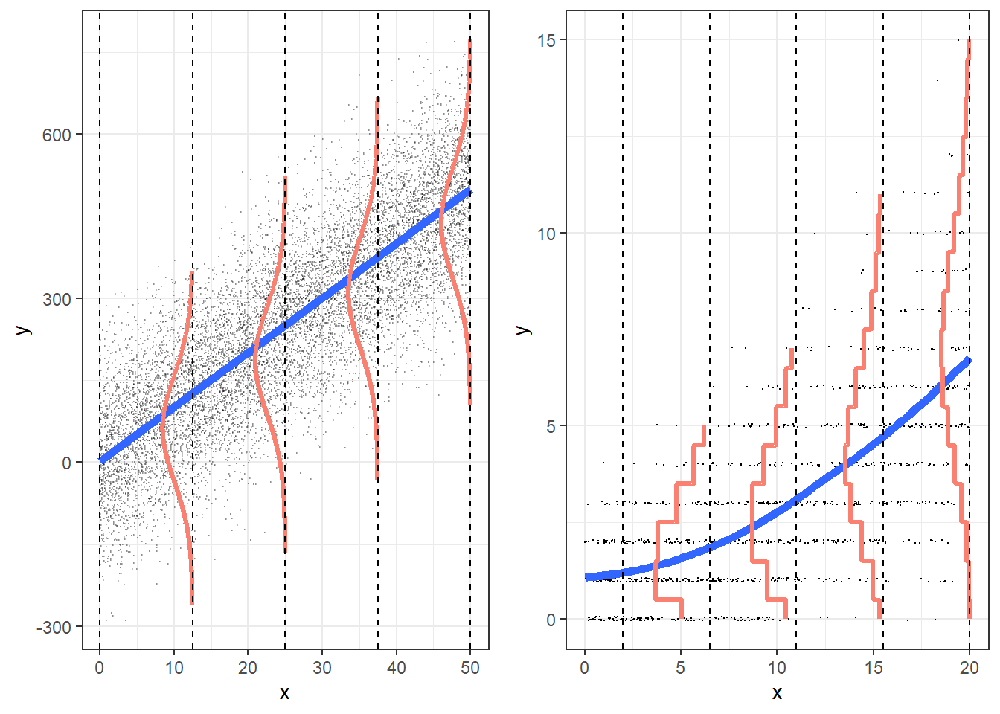

```{r}
#| include: false
#| warning: false
#| message: false

knitr::opts_chunk$set(echo = TRUE, warning = FALSE, message = FALSE,
                      fig.retina = 3, fig.align = 'center')
library(knitr)
library(tidyverse)
library(palmerpenguins)
library(cowplot)
library(moderndive)
library(ggthemes)
library(ISLR)
library(rsample)
library(ggforce)
theme_set(theme_get() + theme(text = element_text(size = 20))) 
```

::::: columns
::: {.column .center width="55%"}
{width="90%"}
:::

::: {.column .center width="45%"}
<br>

[Poisson Regression]{.custom-title}

<br> <br> <br> <br> <br>

[Grayson White]{.custom-subtitle}

[Stat 243 <br> Fall 2026, Week 12]{.custom-subtitle}
:::
:::::

------------------------------------------------------------------------

## Recall: GLMs

A generalized linear model has three components: 

1. A distribution of $y_i$
2. A link function, $g(\mu_i)$, where $\mu_i = \mathbb{E}(y_i)$
3. Linear predictor, $\eta_i$


::: {.fragment}

A GLM is written as follows: 

$$
y_i \overset{\text{ind}}{\sim} Dist(g^{-1}(\eta_i))
$$

where:

::: {.nonincremental}

- $Dist$ is the assumed distribution of $y_i$,
- $g^{-1}(\eta_i)$ is the value of the inverse link, which is $\mu_i$, and 
- $\eta_i$ is the linear predictor. 

:::

:::


## Binary response GLMs

**Logistic Regression:**

$$
y_i \overset{\text{ind}}{\sim} Bern\left(\frac{\exp(\beta_0 + \beta_1 x_{1i} + \cdots + \beta_p x_{pi})}{1 + \exp(\beta_0 + \beta_1 x_{1i} + \cdots + \beta_p x_{pi})}\right)
$$

::: {.nonincremental}


1. Distribution of $y_i$: Bernoulli
2. Link function: logit; $g(p_i) = \log\left(\frac{p_i}{1 - p_i}\right)$, so $p_i = g^{-1}(\eta_i) = \frac{\exp(\eta_i)}{1 + \exp(\eta_i)}$
3. Linear predictor: $\eta_i = \beta_0 + \beta_1 x_{1i} + \cdots + \beta_p x_{pi}$


:::


## Binary response GLMs


::: {.nonincremental}

**Probit Regression:**


$$
y_i \overset{\text{ind}}{\sim} Bern(\Phi(\beta_0 + \beta_1 x_{1i} + \cdots + \beta_p x_{pi}))
$$

1. Distribution of $y_i$: Bernoulli
2. Link function: $g(p_i) = \Phi^{-1}(p_i)$, so $p_i = g^{-1}(\eta_i) = \Phi(\eta_i)$, 
    - where $\Phi(z)$ is the CDF of a standard normal random variable
3. Linear predictor: $\eta_i = \beta_0 + \beta_1 x_{1i} + \cdots + \beta_p x_{pi}$


:::


## Quantitative response GLM

**Linear Regression:**

$$
y_i \overset{\text{ind}}{\sim} N(\beta_0 + \beta_1 x_{1i} + \cdots + \beta_p x_{pi},~ \sigma^2)
$$

::: {.nonincremental}

1. Distribution of $y_i$: Normal
2. Link function: identity; $g(\mu_i) = \mu_i$, so $\mu_i = g^{-1}(\eta_i) = \eta_i$
3. Linear predictor: $\eta_i = \beta_0 + \beta_1 x_{1i} + \cdots + \beta_p x_{pi}$

::: 


## Count response GLM

**Poisson Regression:**
 


 
$$
y_i \overset{\text{ind}}{\sim} Pois\left(\exp(\beta_0 + \beta_1 x_{1i} + \cdots + \beta_p x_{pi})\right)
$$
 
 
::: {.nonincremental}

1. Distribution of $y_i$: Poisson
2. Link function: log; $g(\lambda_i) = \log(\lambda_i)$, so $\lambda_i = g^{-1}(\eta_i) = \exp(\eta_i)$
3. Linear predictor: $\eta_i = \beta_0 + \beta_1 x_{1i} + \cdots + \beta_p x_{pi}$

:::


::: {.fragment .nonincremental}

Recall: If $X \sim Pois(\lambda)$, then:

  - $\mathbb{E}(X) = \lambda$, and
  - $\mathrm{Var}(X) = \lambda$.


:::
 

##  A graphical comparison of Normal and Poisson regression

{width='70%' fig-align='center'}


## Poisson regression assumptions

Now that we have written down the Poisson regression model, 

$$
y_i \overset{\text{ind}}{\sim} Pois\left(\exp(\beta_0 + \beta_1 x_{1i} + \cdots + \beta_p x_{pi})\right)
$$

we can see its assumptions: 

1. **Poisson Response:** The response variable is a count, described by a Poisson distribution.
2. **Independence:** The observations must be independent of one another.
3. **Mean = Variance:** By definition, the mean of a Poisson random variable must be equal to its variance.
4. **Linearity:** The log of the mean rate, $\log(\lambda)$, must be a linear function of $x$.


## Poisson regression in `R`


```{r}
household <- read_csv("https://raw.githubusercontent.com/proback/BeyondMLR/master/data/fHH1.csv")
head(household)
```

- Data on households in the Philippines (more info: [Chapter 4.4 of Beyond MLR](https://bookdown.org/roback/bookdown-BeyondMLR/ch-poissonreg.html))

- Each row represents a household
- `age` = the age of the head of household
- `total` = the number of people in the household other than the head


## Exploratory data analysis

```{r}
ggplot(data = household, mapping = aes(x = total)) + 
  geom_bar()
```


## Poisson regression in `R`


```{r}
mod_pois <- glm(
  formula = total ~ age, 
  data = household, 
  family = poisson(link = "log")
)

broom::tidy(mod_pois)
```


## Plotting Poisson regression in `R`


```{r}
household %>%
  ggplot(aes(x = age, y = total)) +
  geom_point() + 
  geom_smooth(method = "glm", se = FALSE, color = "steelblue",
              method.args = list(family = poisson(link = "log"))) +
  theme_bw()
```


## Plotting Poisson vs linear regression


```{r}
household %>%
  ggplot(aes(x = age, y = total)) +
  geom_point() + 
  geom_smooth(method = "glm", se = FALSE, color = "steelblue",
              method.args = list(family = poisson(link = "log"))) +
  geom_smooth(method = "lm", se = FALSE, color = "tomato", linetype = "dashed") +
  theme_bw()
```

Linear regression produces nearly the same line. Advantages of Poisson regression? 


## Poisson Assumptions: Have we met them?


```{r}
mod_pois <- glm(
  formula = total ~ age, 
  data = household, 
  family = poisson(link = "log")
)

broom::tidy(mod_pois)
```


## Poisson Assumptions

**Poisson Response:** The response variable is a count, described by a Poisson distribution.

```{r}
household %>%
  ggplot(mapping = aes(x = total)) +
  geom_bar() 
```


## Poisson Assumptions

**Poisson Response:** The response variable is a count, described by a Poisson distribution.

```{r}
household %>%
  mutate(age_bin = cut_width(age, width = 10)) %>%
  ggplot(mapping = aes(x = total)) +
  geom_bar() +
  facet_wrap(~age_bin, scales = "free")
```


## Poisson Assumptions

**Independence:** The observations must be independent of one another.

- Check via data context. 


## Poisson Assumptions

**Mean = Variance:** By definition, the mean of a Poisson random variable must be equal to its variance.


```{r}
household %>%
  summarize(mean = mean(total), var = var(total))
```

- Note, this must be true across all "levels" of the predictor(s)!


::: {.fragment}


```{r}
#| output-location: column
household %>%
  mutate(age_bin = cut_width(age, width = 5)) %>%
  group_by(age_bin) %>%
  summarize(mean = mean(total), 
            var = var(total),
            n = n())
```

:::


## Poisson Assumptions

**Linearity:** The log of the mean rate, $\log(\lambda)$, must be a linear function of $x$.

::: {.fragment}


```{r}
household %>%
  group_by(age) %>%
  summarize(empir_log_lambda = log(mean(total))) %>%
  ggplot(aes(x = age, y = empir_log_lambda)) + 
  geom_point()
```

Plot of the log of **empirical** means against predictor levels. **Linear relationship??**


:::


## Poisson Assumptions

Want to fix **linearity** and **Mean = Variance** assumptions. How? 


- **Linearity:** quadratic term will do the trick! 
- **Mean = Variance:** a bit harder... 
    - However, this assumption only causes issues the value of our estimated standard errors (typically, these become under estimated), not our $\hat\beta$'s!
    - We can account for this degradation by estimating a **dispersion** parameter! 
    
    
::: {.fragment}

Dispersion parameter for Poisson regression:

$$
\hat\phi = \left(\sum_{i=1}^n\frac{(y_i - \hat y_i)^2}{\hat y_i} \right) / (n-p)
$$

- If $\hat\phi = 1$ we have perfectly specified dispersion for Poisson regression, $\hat\phi > 1$ implies overdispersion, and $\hat\phi < 1$ implies underdispersion.

:::


## Accounting for Overdispersion

To account for overdispersion in Poisson regression, we multiply the estimated dispersion parameter with the estimated standard errors: 

$$
\widehat{SE}_Q(\hat\beta) = \widehat{SE}(\hat\beta) \cdot \sqrt{\hat\phi}
$$


## Overdispersion via quasi-Poisson

In essence, a dispersion parameter allows us to use the Poisson distribution to model counts through a GLM, when Mean $\neq$ Variance. For details on (over)dispersion, see [Beyond MLR Section 4.9](https://bookdown.org/roback/bookdown-BeyondMLR/ch-poissonreg.html#sec-overdispPois).

::: {.fragment}


In `R`, accounting for overdispersion and non-linearity:

```{r}
mod_quasipois <- glm(total ~ poly(age, degree = 2), 
                     family = quasipoisson, 
                     data = household)
summary(mod_quasipois)
```

:::


## Comparing Poisson and quasi-Poisson


:::: {.columns}


::: {.column}

```{r}
mod_quasipois <- glm(total ~ poly(age, degree = 2), 
                     family = quasipoisson(link = "log"), 
                     data = household)
broom::tidy(mod_quasipois)
```

:::

::: {.column}

```{r}
mod_pois <- glm(total ~ poly(age, degree = 2), 
                family = poisson(link = "log"), 
                data = household)
broom::tidy(mod_pois)
```

:::


::::

------------------------------------------------------------------------

{width='70%' fig-align='center'}

# Have an excellent break! 

See you Monday for linear mixed models. 

